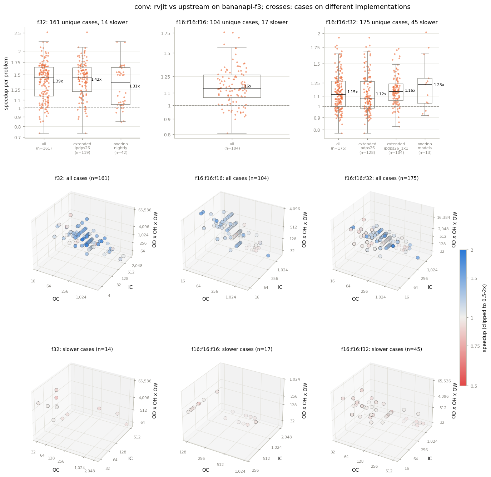
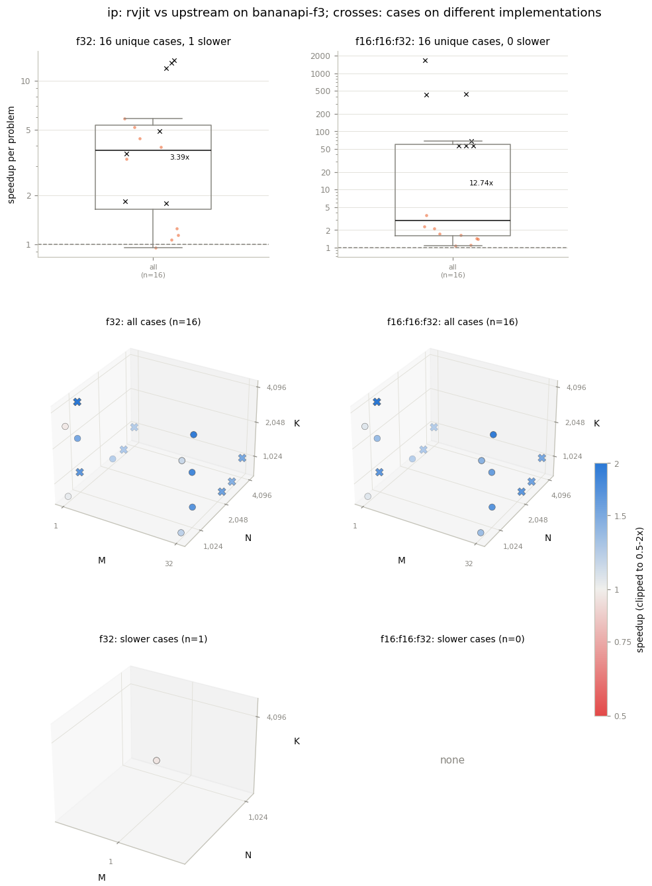
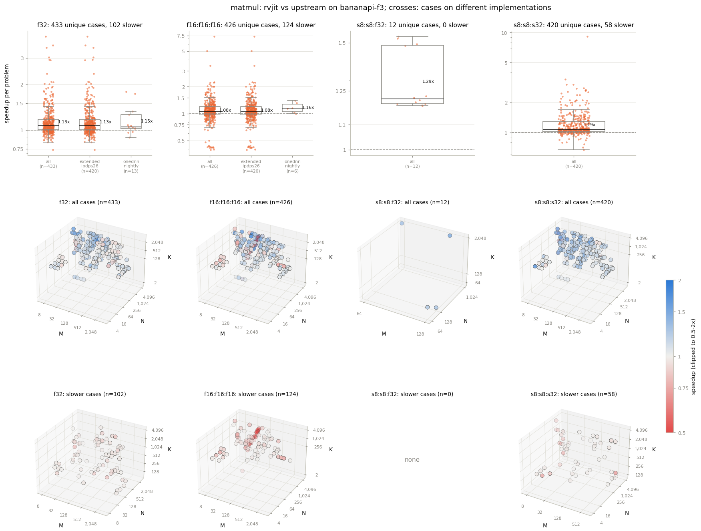

# BananaPi F3: rvjit against upstream

Reference results of this repository's evaluation, to compare yours with.
They come from one run of the 24 jobs (`scripts/slurm/submit.sh run`) on
2026-10-28. `analysis/compare.py` produced the tables and
`analysis/plots.py` the figures, as described in the README's "Analysis".

| | |
|---|---|
| Board | BananaPi F3: SpacemiT K1, 8 SpacemiT X60 cores, VLEN 256 |
| ISA | `rv64imafdcv_..._zvfh_zvfhmin_...`: Zvfh, no Zvfbfmin or Zvfbfwma |
| Threads | 8, one exclusive node per job |
| upstream | oneDNN `d3f8eb8416` |
| rvjit | the PR head `07f60d9f29db`, vendoring rvjit v0.1.0 (`92aba15d36f4`) |
| Build | GCC 14.2 (`rvjit-repro:gcc14` image), `ONEDNN_ENABLE_WORKLOAD=INFERENCE` |

## Summary

- **ctest and correctness:** every test and job passes on rvjit, with the
  same counts as upstream. Upstream fails one problem of
  `correctness-onednn.conv.test_ci`, in the reference int8 GEMM
  (`gemm_s8u8s32:ref`), which rvjit passes.
- **Performance:** geomean speedup over the unique cases of each primitive
  (same-implementation cases for the implementation rows):

| Primitive | Cases | Geomean | Faster | Creation time |
|---|---|---|---|---|
| conv, all | 440 | 1.23 | 364 | 2.19 |
| conv, `jit_1x1:rvv` (f32) | 114 | 1.47 | 113 | 1.89 |
| conv, `brgemm:rvv` (f32) | 33 | 1.29 | 24 | 2.30 |
| conv, `jit_1x1:rvv_zvfh` (f16) | 208 | 1.15 | 173 | 2.20 |
| conv, `brgemm:rvv_zvfh` (f16) | 71 | 1.14 | 44 | 3.13 |
| conv, `gemm:rvv` (f32) | 14 | 1.01 | 10 | 1.02 |
| ip, `brgemm:rvv` (f32) | 9 | 2.39 | 8 | 1.38 |
| ip, `brgemm:rvv_zvfh` (f16) | 9 | 1.71 | 9 | 1.39 |
| matmul, all | 1291 | 1.13 | 1007 | 6.20 |
| matmul, `jit:rvv` (f32, int8) | 864 | 1.16 | 705 | 5.22 |
| matmul, `jit:rvv_zvfh` (f16) | 426 | 1.08 | 302 | 8.80 |

  The creation time is rvjit's over upstream's (< 1 is faster); rvjit tunes
  and generates its kernels when a primitive is created.

## Notes

- **bf16 is skipped:** the board has no Zvfbfwma, so every bf16 problem
  reports as skipped on both builds and `performance-onednn.matmul.models`
  (bf16 only) has no rows.
- **ip, implementation changes:** the `ip, all` rows below are dominated by
  14 cases that change implementation. 7 f16 BERT layers run on
  `ref:any` upstream and `brgemm:rvv_zvfh` in rvjit (56-1678x); 7 f32
  layers move from `gemm:rvv` to `brgemm:rvv` (5.3x).
- **Upstream creation failures:** upstream fails to create 9 f32
  `performance-extended.conv.ipdps26` 1x1 shapes with IC >= 1280 on a 5x5
  output, so that job exits with status 1; rvjit runs them. Likewise
  `correctness-onednn.conv.test_ci` exits with status 1 for upstream's
  failure above.
- **Noise:** the 66 conv cases measured in two jobs differ by 4.6% in
  speedup at the median and up to 1.66x between them, so a single case
  within about 10% of 1x is not significant.
- **Run times:** see the README's "Timing".

## ctest

8 of 8 tests pass on rvjit.

| test | upstream | rvjit | agreement | verdict |
|---|---|---|---|---|
| test_convolution_eltwise_forward_f32 | Passed | Passed | same | PASS |
| test_convolution_eltwise_forward_x8s8f32s32 | Passed | Passed | same | PASS |
| test_convolution_forward_f32 | Passed | Passed | same | PASS |
| test_convolution_forward_u8s8fp | Passed | Passed | same | PASS |
| test_convolution_forward_u8s8s32 | Passed | Passed | same | PASS |
| test_gemm_f32 | Passed | Passed | same | PASS |
| test_inner_product_forward | Passed | Passed | same | PASS |
| test_matmul | Passed | Passed | same | PASS |

## Correctness

8 of 8 runs pass on rvjit. `dispatch` compares the problems each implementation ran (details in the job's report).

| job | dt | threads | tests | upstream | rvjit | dispatch | verdict |
|---|---|---|---|---|---|---|---|
| correctness-extended.conv.smoke | harness | t8 | 121 | 89 passed, 32 skipped | 89 passed, 32 skipped | 2 impls differ | PASS |
| correctness-extended.ip.smoke | harness | t8 | 156 | 117 passed, 39 skipped | 117 passed, 39 skipped | same | PASS |
| correctness-extended.matmul.smoke | harness | t8 | 111 | 94 passed, 17 skipped | 94 passed, 17 skipped | same | PASS |
| correctness-onednn.conv.ci | harness | t8 | 928 | 758 passed, 170 skipped | 758 passed, 170 skipped | same | PASS |
| correctness-onednn.conv.test_ci | harness | t8 | 40338 | 33731 passed, 6588 skipped, 18 mistrusted, 1 failed | 33732 passed, 6588 skipped, 18 mistrusted | same | PASS |
| correctness-onednn.ip.ci | harness | t8 | 1080 | 810 passed, 270 skipped | 810 passed, 270 skipped | 4 impls differ | PASS |
| correctness-onednn.ip.test_ci | harness | t8 | 27861 | 24010 passed, 3847 skipped, 4 mistrusted | 24010 passed, 3847 skipped, 4 mistrusted | 4 impls differ | PASS |
| correctness-onednn.matmul.ci | harness | t8 | 726 | 621 passed, 105 skipped | 621 passed, 105 skipped | same | PASS |

## Cases

1763 unique cases evaluated (1833 measurements). A case is counted once: the performance tables and figures leave out its repeats, within a dataset (the same problem under another name) and across datasets (the primitive tables keep its first dataset).

| driver | measured | unique_cases | repeated_in_dataset | repeated_across_datasets |
|---|---|---|---|---|
| conv | 510 | 440 | 0 | 70 |
| ip | 32 | 32 | 0 | 0 |
| matmul | 1291 | 1291 | 0 | 0 |

Repeated cases (66, with each measurement's speedup)

| driver | case | times | occurrences | speedups |
|---|---|---|---|---|
| conv | `conv --dt=f16:f16:f32 --wtag=any t8 --alg=direct --bia-dt=f32 --dir=FWD_B --dtag=axb --stag=axb mb1ic1024ih14oc256oh14kh1ph0 on jit_1x1:rvv_zvfh jit_1x1:rvv_zvfh True` | 3 | extended-conv-ipdps26: `mb1ic1024ih14oc256oh14kh1ph0nconv118` extended-conv-ipdps26_1x1: `mb1ic1024ih14oc256oh14kh1ph0nconv118` onednn-conv-models: `mb1ic1024ih14oc256oh14kh1ph0n"resnet_50:res4b_branch2a*5"` | 1.05 / 1.09 / 1.03 |
| conv | `conv --dt=f16:f16:f32 --wtag=any t8 --alg=direct --bia-dt=f32 --dir=FWD_B --dtag=axb --stag=axb mb1ic1024ih14oc512oh14kh1ph0 on jit_1x1:rvv_zvfh jit_1x1:rvv_zvfh True` | 2 | extended-conv-ipdps26: `mb1ic1024ih14oc512oh14kh1ph0nconv22` extended-conv-ipdps26_1x1: `mb1ic1024ih14oc512oh14kh1ph0nconv22` | 1.04 / 1.10 |
| conv | `conv --dt=f16:f16:f32 --wtag=any t8 --alg=direct --bia-dt=f32 --dir=FWD_B --dtag=axb --stag=axb mb1ic1280ih5oc192oh5kh1ph0 on jit_1x1:rvv_zvfh jit_1x1:rvv_zvfh True` | 2 | extended-conv-ipdps26: `mb1ic1280ih5oc192oh5kh1ph0nconv91` extended-conv-ipdps26_1x1: `mb1ic1280ih5oc192oh5kh1ph0nconv91` | 0.95 / 1.15 |
| conv | `conv --dt=f16:f16:f32 --wtag=any t8 --alg=direct --bia-dt=f32 --dir=FWD_B --dtag=axb --stag=axb mb1ic1280ih5oc320oh5kh1ph0 on jit_1x1:rvv_zvfh jit_1x1:rvv_zvfh True` | 2 | extended-conv-ipdps26: `mb1ic1280ih5oc320oh5kh1ph0nconv83` extended-conv-ipdps26_1x1: `mb1ic1280ih5oc320oh5kh1ph0nconv83` | 0.96 / 1.04 |
| conv | `conv --dt=f16:f16:f32 --wtag=any t8 --alg=direct --bia-dt=f32 --dir=FWD_B --dtag=axb --stag=axb mb1ic1280ih5oc384oh5kh1ph0 on jit_1x1:rvv_zvfh jit_1x1:rvv_zvfh True` | 2 | extended-conv-ipdps26: `mb1ic1280ih5oc384oh5kh1ph0nconv127` extended-conv-ipdps26_1x1: `mb1ic1280ih5oc384oh5kh1ph0nconv127` | 0.88 / 1.01 |
| conv | `conv --dt=f16:f16:f32 --wtag=any t8 --alg=direct --bia-dt=f32 --dir=FWD_B --dtag=axb --stag=axb mb1ic1280ih5oc448oh5kh1ph0 on jit_1x1:rvv_zvfh jit_1x1:rvv_zvfh True` | 2 | extended-conv-ipdps26: `mb1ic1280ih5oc448oh5kh1ph0nconv10` extended-conv-ipdps26_1x1: `mb1ic1280ih5oc448oh5kh1ph0nconv10` | 1.03 / 1.06 |
| conv | `conv --dt=f16:f16:f32 --wtag=any t8 --alg=direct --bia-dt=f32 --dir=FWD_B --dtag=axb --stag=axb mb1ic128ih28oc128oh28kh3ph1 on brgemm:rvv_zvfh brgemm:rvv_zvfh True` | 2 | extended-conv-ipdps26: `mb1ic128ih28oc128oh28kh3ph1nconv41` onednn-conv-models: `mb1ic128ih28oc128oh28kh3ph1n"resnet_50:res3a_branch2b*4"` | 1.21 / 1.23 |
| conv | `conv --dt=f16:f16:f32 --wtag=any t8 --alg=direct --bia-dt=f32 --dir=FWD_B --dtag=axb --stag=axb mb1ic128ih28oc512oh28kh1ph0 on brgemm:rvv_zvfh brgemm:rvv_zvfh True` | 2 | extended-conv-ipdps26: `mb1ic128ih28oc512oh28kh1ph0nconv51` onednn-conv-models: `mb1ic128ih28oc512oh28kh1ph0n"resnet_50:res3a_branch2c*4"` | 1.92 / 1.75 |
| conv | `conv --dt=f16:f16:f32 --wtag=any t8 --alg=direct --bia-dt=f32 --dir=FWD_B --dtag=axb --stag=axb mb1ic2048ih5oc192oh5kh1ph0 on jit_1x1:rvv_zvfh jit_1x1:rvv_zvfh True` | 2 | extended-conv-ipdps26: `mb1ic2048ih5oc192oh5kh1ph0nconv53` extended-conv-ipdps26_1x1: `mb1ic2048ih5oc192oh5kh1ph0nconv53` | 0.89 / 1.02 |
| conv | `conv --dt=f16:f16:f32 --wtag=any t8 --alg=direct --bia-dt=f32 --dir=FWD_B --dtag=axb --stag=axb mb1ic2048ih5oc320oh5kh1ph0 on jit_1x1:rvv_zvfh jit_1x1:rvv_zvfh True` | 2 | extended-conv-ipdps26: `mb1ic2048ih5oc320oh5kh1ph0nconv149` extended-conv-ipdps26_1x1: `mb1ic2048ih5oc320oh5kh1ph0nconv149` | 0.84 / 0.95 |
| conv | `conv --dt=f16:f16:f32 --wtag=any t8 --alg=direct --bia-dt=f32 --dir=FWD_B --dtag=axb --stag=axb mb1ic2048ih5oc384oh5kh1ph0 on jit_1x1:rvv_zvfh jit_1x1:rvv_zvfh True` | 2 | extended-conv-ipdps26: `mb1ic2048ih5oc384oh5kh1ph0nconv131` extended-conv-ipdps26_1x1: `mb1ic2048ih5oc384oh5kh1ph0nconv131` | 0.91 / 0.95 |
| conv | `conv --dt=f16:f16:f32 --wtag=any t8 --alg=direct --bia-dt=f32 --dir=FWD_B --dtag=axb --stag=axb mb1ic2048ih5oc448oh5kh1ph0 on jit_1x1:rvv_zvfh jit_1x1:rvv_zvfh True` | 2 | extended-conv-ipdps26: `mb1ic2048ih5oc448oh5kh1ph0nconv33` extended-conv-ipdps26_1x1: `mb1ic2048ih5oc448oh5kh1ph0nconv33` | 0.87 / 0.98 |
| conv | `conv --dt=f16:f16:f32 --wtag=any t8 --alg=direct --bia-dt=f32 --dir=FWD_B --dtag=axb --stag=axb mb1ic2048ih7oc512oh7kh1ph0 on jit_1x1:rvv_zvfh jit_1x1:rvv_zvfh True` | 3 | extended-conv-ipdps26: `mb1ic2048ih7oc512oh7kh1ph0nconv68` extended-conv-ipdps26_1x1: `mb1ic2048ih7oc512oh7kh1ph0nconv68` onednn-conv-models: `mb1ic2048ih7oc512oh7kh1ph0n"resnet_50:res5b_branch2a*2"` | 1.64 / 1.58 / 1.64 |
| conv | `conv --dt=f16:f16:f32 --wtag=any t8 --alg=direct --bia-dt=f32 --dir=FWD_B --dtag=axb --stag=axb mb1ic256ih14oc1024oh14kh1ph0 on jit_1x1:rvv_zvfh jit_1x1:rvv_zvfh True` | 3 | extended-conv-ipdps26: `mb1ic256ih14oc1024oh14kh1ph0nconv146` extended-conv-ipdps26_1x1: `mb1ic256ih14oc1024oh14kh1ph0nconv146` onednn-conv-models: `mb1ic256ih14oc1024oh14kh1ph0n"resnet_50:res4a_branch2c*6"` | 1.05 / 1.00 / 1.04 |
| conv | `conv --dt=f16:f16:f32 --wtag=any t8 --alg=direct --bia-dt=f32 --dir=FWD_B --dtag=axb --stag=axb mb1ic256ih14oc128oh14kh1ph0 on jit_1x1:rvv_zvfh jit_1x1:rvv_zvfh True` | 2 | extended-conv-ipdps26: `mb1ic256ih14oc128oh14kh1ph0nconv107` extended-conv-ipdps26_1x1: `mb1ic256ih14oc128oh14kh1ph0nconv107` | 1.03 / 1.01 |
| conv | `conv --dt=f16:f16:f32 --wtag=any t8 --alg=direct --bia-dt=f32 --dir=FWD_B --dtag=axb --stag=axb mb1ic256ih56oc64oh56kh1ph0 on brgemm:rvv_zvfh brgemm:rvv_zvfh True` | 2 | extended-conv-ipdps26: `mb1ic256ih56oc64oh56kh1ph0nconv99` onednn-conv-models: `mb1ic256ih56oc64oh56kh1ph0n"resnet_50:res2b_branch2a*2"` | 0.89 / 0.92 |
| conv | `conv --dt=f16:f16:f32 --wtag=any t8 --alg=direct --bia-dt=f32 --dir=FWD_B --dtag=axb --stag=axb mb1ic288ih14oc128oh14kh1ph0 on jit_1x1:rvv_zvfh jit_1x1:rvv_zvfh True` | 2 | extended-conv-ipdps26: `mb1ic288ih14oc128oh14kh1ph0nconv152` extended-conv-ipdps26_1x1: `mb1ic288ih14oc128oh14kh1ph0nconv152` | 0.98 / 0.98 |
| conv | `conv --dt=f16:f16:f32 --wtag=any t8 --alg=direct --bia-dt=f32 --dir=FWD_B --dtag=axb --stag=axb mb1ic320ih14oc128oh14kh1ph0 on jit_1x1:rvv_zvfh jit_1x1:rvv_zvfh True` | 2 | extended-conv-ipdps26: `mb1ic320ih14oc128oh14kh1ph0nconv35` extended-conv-ipdps26_1x1: `mb1ic320ih14oc128oh14kh1ph0nconv35` | 0.96 / 0.95 |
| conv | `conv --dt=f16:f16:f32 --wtag=any t8 --alg=direct --bia-dt=f32 --dir=FWD_B --dtag=axb --stag=axb mb1ic352ih14oc128oh14kh1ph0 on jit_1x1:rvv_zvfh jit_1x1:rvv_zvfh True` | 2 | extended-conv-ipdps26: `mb1ic352ih14oc128oh14kh1ph0nconv85` extended-conv-ipdps26_1x1: `mb1ic352ih14oc128oh14kh1ph0nconv85` | 0.90 / 0.90 |
| conv | `conv --dt=f16:f16:f32 --wtag=any t8 --alg=direct --bia-dt=f32 --dir=FWD_B --dtag=axb --stag=axb mb1ic384ih14oc128oh14kh1ph0 on jit_1x1:rvv_zvfh jit_1x1:rvv_zvfh True` | 2 | extended-conv-ipdps26: `mb1ic384ih14oc128oh14kh1ph0nconv47` extended-conv-ipdps26_1x1: `mb1ic384ih14oc128oh14kh1ph0nconv47` | 0.97 / 0.98 |
| conv | `conv --dt=f16:f16:f32 --wtag=any t8 --alg=direct --bia-dt=f32 --dir=FWD_B --dtag=axb --stag=axb mb1ic416ih14oc128oh14kh1ph0 on jit_1x1:rvv_zvfh jit_1x1:rvv_zvfh True` | 2 | extended-conv-ipdps26: `mb1ic416ih14oc128oh14kh1ph0nconv119` extended-conv-ipdps26_1x1: `mb1ic416ih14oc128oh14kh1ph0nconv119` | 1.10 / 1.13 |
| conv | `conv --dt=f16:f16:f32 --wtag=any t8 --alg=direct --bia-dt=f32 --dir=FWD_B --dtag=axb --stag=axb mb1ic448ih14oc128oh14kh1ph0 on jit_1x1:rvv_zvfh jit_1x1:rvv_zvfh True` | 2 | extended-conv-ipdps26: `mb1ic448ih14oc128oh14kh1ph0nconv27` extended-conv-ipdps26_1x1: `mb1ic448ih14oc128oh14kh1ph0nconv27` | 1.02 / 1.02 |
| conv | `conv --dt=f16:f16:f32 --wtag=any t8 --alg=direct --bia-dt=f32 --dir=FWD_B --dtag=axb --stag=axb mb1ic480ih14oc128oh14kh1ph0 on jit_1x1:rvv_zvfh jit_1x1:rvv_zvfh True` | 2 | extended-conv-ipdps26: `mb1ic480ih14oc128oh14kh1ph0nconv154` extended-conv-ipdps26_1x1: `mb1ic480ih14oc128oh14kh1ph0nconv154` | 1.02 / 0.94 |
| conv | `conv --dt=f16:f16:f32 --wtag=any t8 --alg=direct --bia-dt=f32 --dir=FWD_B --dtag=axb --stag=axb mb1ic512ih13oc1000oh13kh1ph0 on jit_1x1:rvv_zvfh jit_1x1:rvv_zvfh True` | 2 | extended-conv-ipdps26: `mb1ic512ih13oc1000oh13kh1ph0nconv57` extended-conv-ipdps26_1x1: `mb1ic512ih13oc1000oh13kh1ph0nconv57` | 1.24 / 1.56 |
| conv | `conv --dt=f16:f16:f32 --wtag=any t8 --alg=direct --bia-dt=f32 --dir=FWD_B --dtag=axb --stag=axb mb1ic512ih13oc64oh13kh1ph0 on jit_1x1:rvv_zvfh jit_1x1:rvv_zvfh True` | 2 | extended-conv-ipdps26: `mb1ic512ih13oc64oh13kh1ph0nconv62` extended-conv-ipdps26_1x1: `mb1ic512ih13oc64oh13kh1ph0nconv62` | 1.15 / 1.20 |
| conv | `conv --dt=f16:f16:f32 --wtag=any t8 --alg=direct --bia-dt=f32 --dir=FWD_B --dtag=axb --stag=axb mb1ic512ih14oc128oh14kh1ph0 on jit_1x1:rvv_zvfh jit_1x1:rvv_zvfh True` | 2 | extended-conv-ipdps26: `mb1ic512ih14oc128oh14kh1ph0nconv82` extended-conv-ipdps26_1x1: `mb1ic512ih14oc128oh14kh1ph0nconv82` | 1.10 / 0.86 |
| conv | `conv --dt=f16:f16:f32 --wtag=any t8 --alg=direct --bia-dt=f32 --dir=FWD_B --dtag=axb --stag=axb mb1ic512ih28oc128oh28kh1ph0 on brgemm:rvv_zvfh brgemm:rvv_zvfh True` | 2 | extended-conv-ipdps26: `mb1ic512ih28oc128oh28kh1ph0nconv48` onednn-conv-models: `mb1ic512ih28oc128oh28kh1ph0n"resnet_50:res3b_branch2a*3"` | 1.26 / 1.27 |
| conv | `conv --dt=f16:f16:f32 --wtag=any t8 --alg=direct --bia-dt=f32 --dir=FWD_B --dtag=axb --stag=axb mb1ic512ih7oc128oh7kh1ph0 on jit_1x1:rvv_zvfh jit_1x1:rvv_zvfh True` | 2 | extended-conv-ipdps26: `mb1ic512ih7oc128oh7kh1ph0nconv114` extended-conv-ipdps26_1x1: `mb1ic512ih7oc128oh7kh1ph0nconv114` | 1.53 / 1.39 |
| conv | `conv --dt=f16:f16:f32 --wtag=any t8 --alg=direct --bia-dt=f32 --dir=FWD_B --dtag=axb --stag=axb mb1ic512ih7oc2048oh7kh1ph0 on jit_1x1:rvv_zvfh jit_1x1:rvv_zvfh True` | 3 | extended-conv-ipdps26: `mb1ic512ih7oc2048oh7kh1ph0nconv86` extended-conv-ipdps26_1x1: `mb1ic512ih7oc2048oh7kh1ph0nconv86` onednn-conv-models: `mb1ic512ih7oc2048oh7kh1ph0n"resnet_50:res5a_branch2c*3"` | 1.78 / 1.71 / 2.02 |
| conv | `conv --dt=f16:f16:f32 --wtag=any t8 --alg=direct --bia-dt=f32 --dir=FWD_B --dtag=axb --stag=axb mb1ic544ih14oc128oh14kh1ph0 on jit_1x1:rvv_zvfh jit_1x1:rvv_zvfh True` | 2 | extended-conv-ipdps26: `mb1ic544ih14oc128oh14kh1ph0nconv126` extended-conv-ipdps26_1x1: `mb1ic544ih14oc128oh14kh1ph0nconv126` | 0.99 / 1.05 |
| conv | `conv --dt=f16:f16:f32 --wtag=any t8 --alg=direct --bia-dt=f32 --dir=FWD_B --dtag=axb --stag=axb mb1ic544ih7oc128oh7kh1ph0 on jit_1x1:rvv_zvfh jit_1x1:rvv_zvfh True` | 2 | extended-conv-ipdps26: `mb1ic544ih7oc128oh7kh1ph0nconv37` extended-conv-ipdps26_1x1: `mb1ic544ih7oc128oh7kh1ph0nconv37` | 1.29 / 1.33 |
| conv | `conv --dt=f16:f16:f32 --wtag=any t8 --alg=direct --bia-dt=f32 --dir=FWD_B --dtag=axb --stag=axb mb1ic576ih14oc128oh14kh1ph0 on jit_1x1:rvv_zvfh jit_1x1:rvv_zvfh True` | 2 | extended-conv-ipdps26: `mb1ic576ih14oc128oh14kh1ph0nconv32` extended-conv-ipdps26_1x1: `mb1ic576ih14oc128oh14kh1ph0nconv32` | 0.97 / 1.04 |
| conv | `conv --dt=f16:f16:f32 --wtag=any t8 --alg=direct --bia-dt=f32 --dir=FWD_B --dtag=axb --stag=axb mb1ic576ih7oc128oh7kh1ph0 on jit_1x1:rvv_zvfh jit_1x1:rvv_zvfh True` | 2 | extended-conv-ipdps26: `mb1ic576ih7oc128oh7kh1ph0nconv70` extended-conv-ipdps26_1x1: `mb1ic576ih7oc128oh7kh1ph0nconv70` | 1.33 / 1.29 |
| conv | `conv --dt=f16:f16:f32 --wtag=any t8 --alg=direct --bia-dt=f32 --dir=FWD_B --dtag=axb --stag=axb mb1ic608ih14oc128oh14kh1ph0 on jit_1x1:rvv_zvfh jit_1x1:rvv_zvfh True` | 2 | extended-conv-ipdps26: `mb1ic608ih14oc128oh14kh1ph0nconv59` extended-conv-ipdps26_1x1: `mb1ic608ih14oc128oh14kh1ph0nconv59` | 1.00 / 1.04 |
| conv | `conv --dt=f16:f16:f32 --wtag=any t8 --alg=direct --bia-dt=f32 --dir=FWD_B --dtag=axb --stag=axb mb1ic608ih7oc128oh7kh1ph0 on jit_1x1:rvv_zvfh jit_1x1:rvv_zvfh True` | 2 | extended-conv-ipdps26: `mb1ic608ih7oc128oh7kh1ph0nconv69` extended-conv-ipdps26_1x1: `mb1ic608ih7oc128oh7kh1ph0nconv69` | 1.25 / 1.29 |
| conv | `conv --dt=f16:f16:f32 --wtag=any t8 --alg=direct --bia-dt=f32 --dir=FWD_B --dtag=axb --stag=axb mb1ic640ih14oc128oh14kh1ph0 on jit_1x1:rvv_zvfh jit_1x1:rvv_zvfh True` | 2 | extended-conv-ipdps26: `mb1ic640ih14oc128oh14kh1ph0nconv101` extended-conv-ipdps26_1x1: `mb1ic640ih14oc128oh14kh1ph0nconv101` | 1.10 / 1.13 |
| conv | `conv --dt=f16:f16:f32 --wtag=any t8 --alg=direct --bia-dt=f32 --dir=FWD_B --dtag=axb --stag=axb mb1ic640ih7oc128oh7kh1ph0 on jit_1x1:rvv_zvfh jit_1x1:rvv_zvfh True` | 2 | extended-conv-ipdps26: `mb1ic640ih7oc128oh7kh1ph0nconv0` extended-conv-ipdps26_1x1: `mb1ic640ih7oc128oh7kh1ph0nconv0` | 1.19 / 1.49 |
| conv | `conv --dt=f16:f16:f32 --wtag=any t8 --alg=direct --bia-dt=f32 --dir=FWD_B --dtag=axb --stag=axb mb1ic64ih13oc256oh13kh1ph0 on jit_1x1:rvv_zvfh jit_1x1:rvv_zvfh True` | 2 | extended-conv-ipdps26: `mb1ic64ih13oc256oh13kh1ph0nconv132` extended-conv-ipdps26_1x1: `mb1ic64ih13oc256oh13kh1ph0nconv132` | 1.07 / 1.14 |
| conv | `conv --dt=f16:f16:f32 --wtag=any t8 --alg=direct --bia-dt=f32 --dir=FWD_B --dtag=axb --stag=axb mb1ic64ih56oc256oh56kh1ph0 on brgemm:rvv_zvfh brgemm:rvv_zvfh True` | 2 | extended-conv-ipdps26: `mb1ic64ih56oc256oh56kh1ph0nconv17` onednn-conv-models: `mb1ic64ih56oc256oh56kh1ph0n"resnet_50:res2a_branch1*4"` | 1.15 / 1.11 |
| conv | `conv --dt=f16:f16:f32 --wtag=any t8 --alg=direct --bia-dt=f32 --dir=FWD_B --dtag=axb --stag=axb mb1ic64ih56oc64oh56kh1ph0 on brgemm:rvv_zvfh brgemm:rvv_zvfh True` | 2 | extended-conv-ipdps26: `mb1ic64ih56oc64oh56kh1ph0nconv60` onednn-conv-models: `mb1ic64ih56oc64oh56kh1ph0n"resnet_50:res2a_branch2a"` | 0.94 / 0.93 |
| conv | `conv --dt=f16:f16:f32 --wtag=any t8 --alg=direct --bia-dt=f32 --dir=FWD_B --dtag=axb --stag=axb mb1ic64ih56oc64oh56kh3ph1 on brgemm:rvv_zvfh brgemm:rvv_zvfh True` | 2 | extended-conv-ipdps26: `mb1ic64ih56oc64oh56kh3ph1nconv77` onednn-conv-models: `mb1ic64ih56oc64oh56kh3ph1n"resnet_50:res2a_branch2b*3"` | 0.96 / 0.96 |
| conv | `conv --dt=f16:f16:f32 --wtag=any t8 --alg=direct --bia-dt=f32 --dir=FWD_B --dtag=axb --stag=axb mb1ic672ih14oc128oh14kh1ph0 on jit_1x1:rvv_zvfh jit_1x1:rvv_zvfh True` | 2 | extended-conv-ipdps26: `mb1ic672ih14oc128oh14kh1ph0nconv108` extended-conv-ipdps26_1x1: `mb1ic672ih14oc128oh14kh1ph0nconv108` | 0.77 / 1.03 |
| conv | `conv --dt=f16:f16:f32 --wtag=any t8 --alg=direct --bia-dt=f32 --dir=FWD_B --dtag=axb --stag=axb mb1ic672ih7oc128oh7kh1ph0 on jit_1x1:rvv_zvfh jit_1x1:rvv_zvfh True` | 2 | extended-conv-ipdps26: `mb1ic672ih7oc128oh7kh1ph0nconv40` extended-conv-ipdps26_1x1: `mb1ic672ih7oc128oh7kh1ph0nconv40` | 1.37 / 0.83 |
| conv | `conv --dt=f16:f16:f32 --wtag=any t8 --alg=direct --bia-dt=f32 --dir=FWD_B --dtag=axb --stag=axb mb1ic704ih14oc128oh14kh1ph0 on jit_1x1:rvv_zvfh jit_1x1:rvv_zvfh True` | 2 | extended-conv-ipdps26: `mb1ic704ih14oc128oh14kh1ph0nconv5` extended-conv-ipdps26_1x1: `mb1ic704ih14oc128oh14kh1ph0nconv5` | 1.07 / 1.14 |
| conv | `conv --dt=f16:f16:f32 --wtag=any t8 --alg=direct --bia-dt=f32 --dir=FWD_B --dtag=axb --stag=axb mb1ic704ih7oc128oh7kh1ph0 on jit_1x1:rvv_zvfh jit_1x1:rvv_zvfh True` | 2 | extended-conv-ipdps26: `mb1ic704ih7oc128oh7kh1ph0nconv21` extended-conv-ipdps26_1x1: `mb1ic704ih7oc128oh7kh1ph0nconv21` | 1.30 / 1.16 |
| conv | `conv --dt=f16:f16:f32 --wtag=any t8 --alg=direct --bia-dt=f32 --dir=FWD_B --dtag=axb --stag=axb mb1ic736ih14oc128oh14kh1ph0 on jit_1x1:rvv_zvfh jit_1x1:rvv_zvfh True` | 2 | extended-conv-ipdps26: `mb1ic736ih14oc128oh14kh1ph0nconv153` extended-conv-ipdps26_1x1: `mb1ic736ih14oc128oh14kh1ph0nconv153` | 1.08 / 1.08 |
| conv | `conv --dt=f16:f16:f32 --wtag=any t8 --alg=direct --bia-dt=f32 --dir=FWD_B --dtag=axb --stag=axb mb1ic736ih7oc128oh7kh1ph0 on jit_1x1:rvv_zvfh jit_1x1:rvv_zvfh True` | 2 | extended-conv-ipdps26: `mb1ic736ih7oc128oh7kh1ph0nconv46` extended-conv-ipdps26_1x1: `mb1ic736ih7oc128oh7kh1ph0nconv46` | 1.24 / 1.21 |
| conv | `conv --dt=f16:f16:f32 --wtag=any t8 --alg=direct --bia-dt=f32 --dir=FWD_B --dtag=axb --stag=axb mb1ic768ih12oc128oh12kh1ph0 on jit_1x1:rvv_zvfh jit_1x1:rvv_zvfh True` | 2 | extended-conv-ipdps26: `mb1ic768ih12oc128oh12kh1ph0nconv121` extended-conv-ipdps26_1x1: `mb1ic768ih12oc128oh12kh1ph0nconv121` | 1.10 / 1.17 |
| conv | `conv --dt=f16:f16:f32 --wtag=any t8 --alg=direct --bia-dt=f32 --dir=FWD_B --dtag=axb --stag=axb mb1ic768ih12oc160oh12kh1ph0 on jit_1x1:rvv_zvfh jit_1x1:rvv_zvfh True` | 2 | extended-conv-ipdps26: `mb1ic768ih12oc160oh12kh1ph0nconv133` extended-conv-ipdps26_1x1: `mb1ic768ih12oc160oh12kh1ph0nconv133` | 1.16 / 1.22 |
| conv | `conv --dt=f16:f16:f32 --wtag=any t8 --alg=direct --bia-dt=f32 --dir=FWD_B --dtag=axb --stag=axb mb1ic768ih12oc192oh12kh1ph0 on jit_1x1:rvv_zvfh jit_1x1:rvv_zvfh True` | 2 | extended-conv-ipdps26: `mb1ic768ih12oc192oh12kh1ph0nconv123` extended-conv-ipdps26_1x1: `mb1ic768ih12oc192oh12kh1ph0nconv123` | 1.16 / 1.20 |
| conv | `conv --dt=f16:f16:f32 --wtag=any t8 --alg=direct --bia-dt=f32 --dir=FWD_B --dtag=axb --stag=axb mb1ic768ih14oc128oh14kh1ph0 on jit_1x1:rvv_zvfh jit_1x1:rvv_zvfh True` | 2 | extended-conv-ipdps26: `mb1ic768ih14oc128oh14kh1ph0nconv19` extended-conv-ipdps26_1x1: `mb1ic768ih14oc128oh14kh1ph0nconv19` | 1.03 / 1.08 |
| conv | `conv --dt=f16:f16:f32 --wtag=any t8 --alg=direct --bia-dt=f32 --dir=FWD_B --dtag=axb --stag=axb mb1ic768ih7oc128oh7kh1ph0 on jit_1x1:rvv_zvfh jit_1x1:rvv_zvfh True` | 2 | extended-conv-ipdps26: `mb1ic768ih7oc128oh7kh1ph0nconv50` extended-conv-ipdps26_1x1: `mb1ic768ih7oc128oh7kh1ph0nconv50` | 1.30 / 1.36 |
| conv | `conv --dt=f16:f16:f32 --wtag=any t8 --alg=direct --bia-dt=f32 --dir=FWD_B --dtag=axb --stag=axb mb1ic800ih14oc128oh14kh1ph0 on jit_1x1:rvv_zvfh jit_1x1:rvv_zvfh True` | 2 | extended-conv-ipdps26: `mb1ic800ih14oc128oh14kh1ph0nconv31` extended-conv-ipdps26_1x1: `mb1ic800ih14oc128oh14kh1ph0nconv31` | 1.05 / 1.03 |
| conv | `conv --dt=f16:f16:f32 --wtag=any t8 --alg=direct --bia-dt=f32 --dir=FWD_B --dtag=axb --stag=axb mb1ic800ih7oc128oh7kh1ph0 on jit_1x1:rvv_zvfh jit_1x1:rvv_zvfh True` | 2 | extended-conv-ipdps26: `mb1ic800ih7oc128oh7kh1ph0nconv9` extended-conv-ipdps26_1x1: `mb1ic800ih7oc128oh7kh1ph0nconv9` | 1.31 / 1.21 |
| conv | `conv --dt=f16:f16:f32 --wtag=any t8 --alg=direct --bia-dt=f32 --dir=FWD_B --dtag=axb --stag=axb mb1ic832ih14oc128oh14kh1ph0 on jit_1x1:rvv_zvfh jit_1x1:rvv_zvfh True` | 2 | extended-conv-ipdps26: `mb1ic832ih14oc128oh14kh1ph0nconv74` extended-conv-ipdps26_1x1: `mb1ic832ih14oc128oh14kh1ph0nconv74` | 1.13 / 1.16 |
| conv | `conv --dt=f16:f16:f32 --wtag=any t8 --alg=direct --bia-dt=f32 --dir=FWD_B --dtag=axb --stag=axb mb1ic832ih7oc128oh7kh1ph0 on jit_1x1:rvv_zvfh jit_1x1:rvv_zvfh True` | 2 | extended-conv-ipdps26: `mb1ic832ih7oc128oh7kh1ph0nconv11` extended-conv-ipdps26_1x1: `mb1ic832ih7oc128oh7kh1ph0nconv11` | 1.39 / 1.30 |
| conv | `conv --dt=f16:f16:f32 --wtag=any t8 --alg=direct --bia-dt=f32 --dir=FWD_B --dtag=axb --stag=axb mb1ic864ih14oc128oh14kh1ph0 on jit_1x1:rvv_zvfh jit_1x1:rvv_zvfh True` | 2 | extended-conv-ipdps26: `mb1ic864ih14oc128oh14kh1ph0nconv138` extended-conv-ipdps26_1x1: `mb1ic864ih14oc128oh14kh1ph0nconv138` | 1.09 / 1.17 |
| conv | `conv --dt=f16:f16:f32 --wtag=any t8 --alg=direct --bia-dt=f32 --dir=FWD_B --dtag=axb --stag=axb mb1ic864ih7oc128oh7kh1ph0 on jit_1x1:rvv_zvfh jit_1x1:rvv_zvfh True` | 2 | extended-conv-ipdps26: `mb1ic864ih7oc128oh7kh1ph0nconv28` extended-conv-ipdps26_1x1: `mb1ic864ih7oc128oh7kh1ph0nconv28` | 1.30 / 1.27 |
| conv | `conv --dt=f16:f16:f32 --wtag=any t8 --alg=direct --bia-dt=f32 --dir=FWD_B --dtag=axb --stag=axb mb1ic896ih14oc128oh14kh1ph0 on jit_1x1:rvv_zvfh jit_1x1:rvv_zvfh True` | 2 | extended-conv-ipdps26: `mb1ic896ih14oc128oh14kh1ph0nconv25` extended-conv-ipdps26_1x1: `mb1ic896ih14oc128oh14kh1ph0nconv25` | 1.07 / 1.09 |
| conv | `conv --dt=f16:f16:f32 --wtag=any t8 --alg=direct --bia-dt=f32 --dir=FWD_B --dtag=axb --stag=axb mb1ic896ih7oc128oh7kh1ph0 on jit_1x1:rvv_zvfh jit_1x1:rvv_zvfh True` | 2 | extended-conv-ipdps26: `mb1ic896ih7oc128oh7kh1ph0nconv61` extended-conv-ipdps26_1x1: `mb1ic896ih7oc128oh7kh1ph0nconv61` | 1.26 / 1.21 |
| conv | `conv --dt=f16:f16:f32 --wtag=any t8 --alg=direct --bia-dt=f32 --dir=FWD_B --dtag=axb --stag=axb mb1ic928ih14oc128oh14kh1ph0 on jit_1x1:rvv_zvfh jit_1x1:rvv_zvfh True` | 2 | extended-conv-ipdps26: `mb1ic928ih14oc128oh14kh1ph0nconv76` extended-conv-ipdps26_1x1: `mb1ic928ih14oc128oh14kh1ph0nconv76` | 1.08 / 1.10 |
| conv | `conv --dt=f16:f16:f32 --wtag=any t8 --alg=direct --bia-dt=f32 --dir=FWD_B --dtag=axb --stag=axb mb1ic928ih7oc128oh7kh1ph0 on jit_1x1:rvv_zvfh jit_1x1:rvv_zvfh True` | 2 | extended-conv-ipdps26: `mb1ic928ih7oc128oh7kh1ph0nconv97` extended-conv-ipdps26_1x1: `mb1ic928ih7oc128oh7kh1ph0nconv97` | 1.31 / 1.30 |
| conv | `conv --dt=f16:f16:f32 --wtag=any t8 --alg=direct --bia-dt=f32 --dir=FWD_B --dtag=axb --stag=axb mb1ic960ih14oc128oh14kh1ph0 on jit_1x1:rvv_zvfh jit_1x1:rvv_zvfh True` | 2 | extended-conv-ipdps26: `mb1ic960ih14oc128oh14kh1ph0nconv144` extended-conv-ipdps26_1x1: `mb1ic960ih14oc128oh14kh1ph0nconv144` | 1.08 / 1.14 |
| conv | `conv --dt=f16:f16:f32 --wtag=any t8 --alg=direct --bia-dt=f32 --dir=FWD_B --dtag=axb --stag=axb mb1ic960ih7oc128oh7kh1ph0 on jit_1x1:rvv_zvfh jit_1x1:rvv_zvfh True` | 2 | extended-conv-ipdps26: `mb1ic960ih7oc128oh7kh1ph0nconv142` extended-conv-ipdps26_1x1: `mb1ic960ih7oc128oh7kh1ph0nconv142` | 1.18 / 1.20 |
| conv | `conv --dt=f16:f16:f32 --wtag=any t8 --alg=direct --bia-dt=f32 --dir=FWD_B --dtag=axb --stag=axb mb1ic992ih14oc128oh14kh1ph0 on jit_1x1:rvv_zvfh jit_1x1:rvv_zvfh True` | 2 | extended-conv-ipdps26: `mb1ic992ih14oc128oh14kh1ph0nconv93` extended-conv-ipdps26_1x1: `mb1ic992ih14oc128oh14kh1ph0nconv93` | 1.07 / 1.19 |
| conv | `conv --dt=f16:f16:f32 --wtag=any t8 --alg=direct --bia-dt=f32 --dir=FWD_B --dtag=axb --stag=axb mb1ic992ih7oc128oh7kh1ph0 on jit_1x1:rvv_zvfh jit_1x1:rvv_zvfh True` | 2 | extended-conv-ipdps26: `mb1ic992ih7oc128oh7kh1ph0nconv80` extended-conv-ipdps26_1x1: `mb1ic992ih7oc128oh7kh1ph0nconv80` | 1.18 / 1.27 |

## Performance

### conv

Per data type: the speedup of every unique case per dataset; its heatmap over the problem's dimensions; the heatmap of the cases slower than the baseline. Crosses mark cases that ran on different implementations.

Ensemble of its datasets:

| rvjit_impl | dt | problems | speedup_geomean | speedup_median | speedup_min | speedup_max | faster | ctime_ratio_geomean |
|---|---|---|---|---|---|---|---|---|
| all | all | 440 | 1.232 | 1.188 | 0.735 | 2.516 | 364 | 2.190 |
| all | f16:f16:f32 | 175 | 1.145 | 1.117 | 0.774 | 1.921 | 130 | 2.676 |
| all | f32 | 161 | 1.387 | 1.453 | 0.735 | 2.516 | 147 | 1.863 |
| all | f16:f16:f16 | 104 | 1.159 | 1.142 | 0.806 | 1.757 | 87 | 2.008 |
| jit_1x1:rvv_zvfh | all | 208 | 1.154 | 1.140 | 0.774 | 1.783 | 173 | 2.198 |
| brgemm:rvv_zvfh | all | 71 | 1.141 | 1.063 | 0.893 | 1.921 | 44 | 3.126 |
| jit_1x1:rvv | all | 114 | 1.473 | 1.509 | 0.874 | 2.080 | 113 | 1.887 |
| brgemm:rvv | all | 33 | 1.289 | 1.187 | 0.735 | 2.516 | 24 | 2.297 |
| gemm:rvv | all | 14 | 1.010 | 1.039 | 0.847 | 1.095 | 10 | 1.025 |
| jit_1x1:rvv_zvfh | f16:f16:f32 | 104 | 1.148 | 1.133 | 0.774 | 1.783 | 86 | 2.407 |
| brgemm:rvv_zvfh | f16:f16:f32 | 71 | 1.141 | 1.063 | 0.893 | 1.921 | 44 | 3.126 |
| jit_1x1:rvv | f32 | 114 | 1.473 | 1.509 | 0.874 | 2.080 | 113 | 1.887 |
| brgemm:rvv | f32 | 33 | 1.289 | 1.187 | 0.735 | 2.516 | 24 | 2.297 |
| jit_1x1:rvv_zvfh | f16:f16:f16 | 104 | 1.159 | 1.142 | 0.806 | 1.757 | 87 | 2.008 |
| gemm:rvv | f32 | 14 | 1.010 | 1.039 | 0.847 | 1.095 | 10 | 1.025 |

#### extended-conv-ipdps26

| upstream_impl | rvjit_impl | problems | speedup_geomean | speedup_median | speedup_min | speedup_max | faster | ctime_ratio_geomean |
|---|---|---|---|---|---|---|---|---|
| all | all | 247 | 1.256 | 1.249 | 0.735 | 2.516 | 196 | 2.325 |
| jit_1x1:rvv_zvfh | jit_1x1:rvv_zvfh | 59 | 1.108 | 1.078 | 0.774 | 1.783 | 44 | 1.931 |
| brgemm:rvv_zvfh | brgemm:rvv_zvfh | 69 | 1.137 | 1.053 | 0.893 | 1.921 | 42 | 3.192 |
| jit_1x1:rvv | jit_1x1:rvv | 95 | 1.470 | 1.505 | 0.874 | 2.080 | 94 | 1.984 |
| brgemm:rvv | brgemm:rvv | 24 | 1.220 | 1.097 | 0.735 | 2.516 | 16 | 2.765 |

#### extended-conv-ipdps26_1x1

| upstream_impl | rvjit_impl | problems | speedup_geomean | speedup_median | speedup_min | speedup_max | faster | ctime_ratio_geomean |
|---|---|---|---|---|---|---|---|---|
| all | all | 208 | 1.161 | 1.147 | 0.806 | 1.757 | 177 | 2.202 |
| jit_1x1:rvv_zvfh | jit_1x1:rvv_zvfh | 208 | 1.161 | 1.147 | 0.806 | 1.757 | 177 | 2.202 |

#### onednn-conv-models

| upstream_impl | rvjit_impl | problems | speedup_geomean | speedup_median | speedup_min | speedup_max | faster | ctime_ratio_geomean |
|---|---|---|---|---|---|---|---|---|
| all | all | 13 | 1.228 | 1.231 | 0.918 | 2.018 | 10 | 1.512 |
| brgemm:rvv_zvfh | brgemm:rvv_zvfh | 9 | 1.169 | 1.231 | 0.918 | 1.748 | 6 | 1.542 |
| jit_1x1:rvv_zvfh | jit_1x1:rvv_zvfh | 4 | 1.372 | 1.341 | 1.030 | 2.018 | 4 | 1.447 |

#### onednn-conv-nightly

| upstream_impl | rvjit_impl | problems | speedup_geomean | speedup_median | speedup_min | speedup_max | faster | ctime_ratio_geomean |
|---|---|---|---|---|---|---|---|---|
| all | all | 42 | 1.307 | 1.356 | 0.847 | 2.241 | 37 | 1.289 |
| jit_1x1:rvv | jit_1x1:rvv | 19 | 1.485 | 1.544 | 1.139 | 1.690 | 19 | 1.466 |
| brgemm:rvv | brgemm:rvv | 9 | 1.494 | 1.645 | 0.996 | 2.241 | 8 | 1.402 |
| gemm:rvv | gemm:rvv | 14 | 1.010 | 1.039 | 0.847 | 1.095 | 10 | 1.025 |

### ip

Per data type: the speedup of every unique case per dataset; its heatmap over the problem's dimensions; the heatmap of the cases slower than the baseline. Crosses mark cases that ran on different implementations.

Ensemble of its datasets:

| rvjit_impl | dt | problems | speedup_geomean | speedup_median | speedup_min | speedup_max | faster | ctime_ratio_geomean |
|---|---|---|---|---|---|---|---|---|
| all | all | 32 | 6.569 | 3.583 | 0.955 | 1677.843 | 31 | 1.426 |
| all | f32 | 16 | 3.388 | 3.761 | 0.955 | 13.356 | 15 | 1.405 |
| all | f16:f16:f32 | 16 | 12.736 | 2.951 | 1.086 | 1677.843 | 16 | 1.447 |
| brgemm:rvv | all | 9 | 2.392 | 3.336 | 0.955 | 5.880 | 8 | 1.376 |
| brgemm:rvv_zvfh | all | 9 | 1.706 | 1.650 | 1.086 | 3.580 | 9 | 1.393 |
| brgemm:rvv | f32 | 9 | 2.392 | 3.336 | 0.955 | 5.880 | 8 | 1.376 |
| brgemm:rvv_zvfh | f16:f16:f32 | 9 | 1.706 | 1.650 | 1.086 | 3.580 | 9 | 1.393 |

#### onednn-ip-models

| upstream_impl | rvjit_impl | problems | speedup_geomean | speedup_median | speedup_min | speedup_max | faster | ctime_ratio_geomean |
|---|---|---|---|---|---|---|---|---|
| all | all | 32 | 6.569 | 3.583 | 0.955 | 1677.843 | 31 | 1.426 |
| brgemm:rvv | brgemm:rvv | 9 | 2.392 | 3.336 | 0.955 | 5.880 | 8 | 1.376 |
| brgemm:rvv_zvfh | brgemm:rvv_zvfh | 9 | 1.706 | 1.650 | 1.086 | 3.580 | 9 | 1.393 |
| gemm:rvv | brgemm:rvv | 7 | 5.300 | 4.922 | 1.774 | 13.356 | 7 | 1.444 |
| ref:any | brgemm:rvv_zvfh | 7 | 168.825 | 69.017 | 56.386 | 1677.843 | 7 | 1.519 |

### matmul

Per data type: the speedup of every unique case per dataset; its heatmap over the problem's dimensions; the heatmap of the cases slower than the baseline. Crosses mark cases that ran on different implementations.

Ensemble of its datasets:

| rvjit_impl | dt | problems | speedup_geomean | speedup_median | speedup_min | speedup_max | faster | ctime_ratio_geomean |
|---|---|---|---|---|---|---|---|---|
| all | all | 1291 | 1.134 | 1.067 | 0.394 | 9.154 | 1007 | 6.196 |
| all | f16:f16:f16 | 426 | 1.082 | 1.055 | 0.394 | 7.324 | 302 | 8.803 |
| all | f32 | 433 | 1.131 | 1.067 | 0.742 | 4.162 | 331 | 3.472 |
| all | s8:s8:s32 | 420 | 1.189 | 1.076 | 0.673 | 9.154 | 362 | 8.199 |
| all | s8:s8:f32 | 12 | 1.295 | 1.212 | 1.181 | 1.537 | 12 | 1.565 |
| jit:rvv_zvfh | all | 426 | 1.082 | 1.055 | 0.394 | 7.324 | 302 | 8.803 |
| jit:rvv | all | 864 | 1.161 | 1.073 | 0.673 | 9.154 | 705 | 5.222 |
| gemm:jit:f32 | all | 1 | 0.893 | 0.893 | 0.893 | 0.893 | 0 | 1.037 |
| jit:rvv_zvfh | f16:f16:f16 | 426 | 1.082 | 1.055 | 0.394 | 7.324 | 302 | 8.803 |
| jit:rvv | f32 | 432 | 1.132 | 1.067 | 0.742 | 4.162 | 331 | 3.482 |
| jit:rvv | s8:s8:s32 | 420 | 1.189 | 1.076 | 0.673 | 9.154 | 362 | 8.199 |
| gemm:jit:f32 | f32 | 1 | 0.893 | 0.893 | 0.893 | 0.893 | 0 | 1.037 |
| jit:rvv | s8:s8:f32 | 12 | 1.295 | 1.212 | 1.181 | 1.537 | 12 | 1.565 |

#### extended-matmul-ipdps26

| upstream_impl | rvjit_impl | problems | speedup_geomean | speedup_median | speedup_min | speedup_max | faster | ctime_ratio_geomean |
|---|---|---|---|---|---|---|---|---|
| all | all | 1260 | 1.132 | 1.066 | 0.394 | 9.154 | 980 | 6.418 |
| jit:rvv_zvfh | jit:rvv_zvfh | 420 | 1.081 | 1.053 | 0.394 | 7.324 | 297 | 9.007 |
| jit:rvv | jit:rvv | 840 | 1.159 | 1.070 | 0.673 | 9.154 | 683 | 5.418 |

#### onednn-matmul-nightly

| upstream_impl | rvjit_impl | problems | speedup_geomean | speedup_median | speedup_min | speedup_max | faster | ctime_ratio_geomean |
|---|---|---|---|---|---|---|---|---|
| all | all | 31 | 1.205 | 1.190 | 0.893 | 1.797 | 27 | 1.480 |
| gemm:jit:f32 | gemm:jit:f32 | 1 | 0.893 | 0.893 | 0.893 | 0.893 | 0 | 1.037 |
| jit:rvv | jit:rvv | 24 | 1.231 | 1.194 | 0.964 | 1.797 | 22 | 1.434 |
| jit:rvv_zvfh | jit:rvv_zvfh | 6 | 1.162 | 1.145 | 0.996 | 1.396 | 5 | 1.782 |
